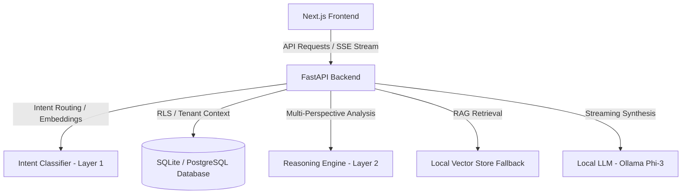

# APEX (Account Planning & Execution Intelligence) Project Analysis Report

This report provides a comprehensive, developer-ready analysis of the APEX project, covering its architecture, component-level workflows, database and security patterns, data model, and frontend design.

---

## 🏛️ System Architecture Overview

APEX is a multi-tenant, AI-powered account intelligence platform designed to automate CRM analysis, risk detection, and account planning. It is split into a **FastAPI** backend and a **Next.js** frontend.



---

## 🔌 Backend Implementation Detail

The backend is built using **FastAPI** and is located under the `/backend` directory.

### 1. Layer 1: Intent Classification & Routing (`intent_classifier.py`)
- **Hybrid Router**: Combines a deterministic embedding similarity router with symbolic regex-based matches.
- **Fast-Path Semantic Lookup**: Uses `SentenceTransformer('all-MiniLM-L6-v2')` to pre-calculate and compare query embeddings against high-confidence seed queries.
- **Greeting/Chitchat Filter**: Instantly detects and intercepts generic greetings (e.g., "hello", "hi") or off-topic queries, returning low-latency conversational responses without triggering data retrieval pipelines.
- **Entity Extraction**: Regex and rule-based parsing extracts parameters such as target accounts (e.g., Wipro, TCS), business metrics, opportunity stages, and timeframes.

### 2. Layer 2: Reasoning Engine (`reasoning_engine.py`)
- **Multi-Perspective Synthesis**: Runs structured analysis threads representing three professional viewpoints:
  1. **Account Manager (AM)**: Focuses on relationship history, contact mapping, and single-threaded deal risks.
  2. **VP of Sales**: Focuses on pipeline revenue, weighted forecast probability, contract close dates, and stalled opportunities.
  3. **Data Analyst**: Focuses on quantitative performance metrics, activity count trends, and support ticket SLAs.
- **Consensus Generation**: Synthesizes the outputs of these three personas into a single, cohesive account briefing.

### 3. Layer 3: Narrative & Streaming Generator (`intelligence_layer.py` / `main.py`)
- **Grounding and Guardrails**: Formulates prompts that restrict the LLM to database context, preventing hallucinations.
- **Structured Contracts**: Uses custom output templates (`OUTPUT_CONTRACT_MAP`) based on the intent (e.g., `RISK_ANALYSIS_QUERY`, `ACCOUNT_PLAN_QUERY`, `CONTACT_QUERY`) to enforce consistent markdown sections.
- **Streaming Response**: Serves responses using Server-Sent Events (SSE) to ensure real-time rendering.

### 4. Database Access & Multi-Tenant Isolation (`database.py` / `models/`)
- **ContextVar-Based Multi-Tenancy**: The active user ID is captured in an async-safe `ContextVar` (`current_user_id_var`).
- **SQLAlchemy Event Listener**: Enforces database-level separation using a listener that automatically executes `SET LOCAL app.current_user_id = '<user_id>';` prior to any query execution.
- **Role Switching**: RLS is strictly enforced by executing `SET ROLE authenticated;` for tenant operations, while system processes run under `RESET ROLE;`.

### 5. Vector Store Fallback (`vector_store.py`)
- **Fallback Database**: If a remote vector database is unavailable, semantic search falls back to a TF-IDF/Keyword keyword-matching mechanism.
- **Local Persistence**: Results are cached and persisted locally in `./fallback_db.json`.

---

## 🎨 Frontend Implementation Detail

The frontend is built using **Next.js 15+** and **React 19** under the `/frontend` directory.

### 1. Routing & Pages Layout (`src/app/`)
- **Shared Layouts**: Root layouts integrate Tailwind styling, global contexts, and custom scrollbars.
- **Dashboard Groups**: Pages are organized under a `(dashboard)` route group:
  - `/dashboard`: High-level metrics, portfolio health status, and action recommendations.
  - `/accounts`: Comprehensive view of synced corporate accounts and detailed reviews.
  - `/pipeline`: Interactive deal tracking and forecast graphs.
  - `/intelligence`: AI Chat copilot interface with live response rendering.
  - `/settings`: Connection details, API configuration, and CRM synchronization settings.

### 2. Styling & Visualization
- **Tailwind CSS**: Core styles use cohesive custom HSL values to support premium modern themes (light/dark glassmorphism).
- **Visualization (Recharts)**: Clean charts representing deal stages, win rates, and historical revenue trends.
- **Framer Motion**: Smooth entry transitions, interactive status badges, and loading skeleton states.

---

## 🔒 Security & Reliability Hardening

1. **Row-Level Security (RLS)**: Enforced on `accounts`, `opportunities`, `contacts`, `cases`, and `activities` to ensure users cannot view or edit other tenants' data.
2. **Slowapi Rate Limiting**: Limit of 30 requests/minute on the `/api/chat` route.
3. **Optimized Testing Hook**: The API supports `x-test-mock: true` header to instantly return a streaming mock response, bypassing Ollama LLM execution for synchronous testing.

---

## 📊 Data Schema Reference

CRM data syncs with the following key tables:
- **`accounts`**: Profile, tiers, annual revenue, and geographic territories.
- **`opportunities`**: Deal sizes, sales stages, win probabilities, and competitors.
- **`contacts`**: Roles, engagement scores, and job levels.
- **`activities`**: Timeline of email, call, and meeting interactions.
- **`cases`**: Support tickets, severity level, status, and resolution timelines.

---

## 🚀 Execution & Verification Commands

### Start the Backend
```bash
cd backend
poetry run uvicorn main:app --reload --port 8001
```

### Start the Frontend
```bash
cd frontend
npm run dev
```

### Run Tests & Verification
- **RLS Verification**: `poetry run pytest tests/test_rls.py`
- **End-to-End Database Sync**: `poetry run python verify_all.py`
