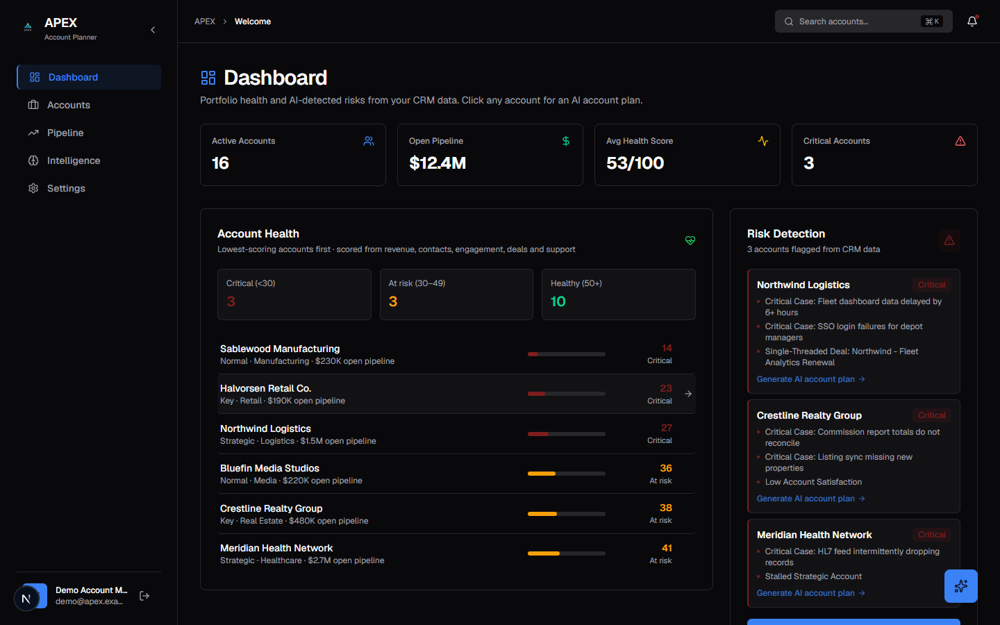
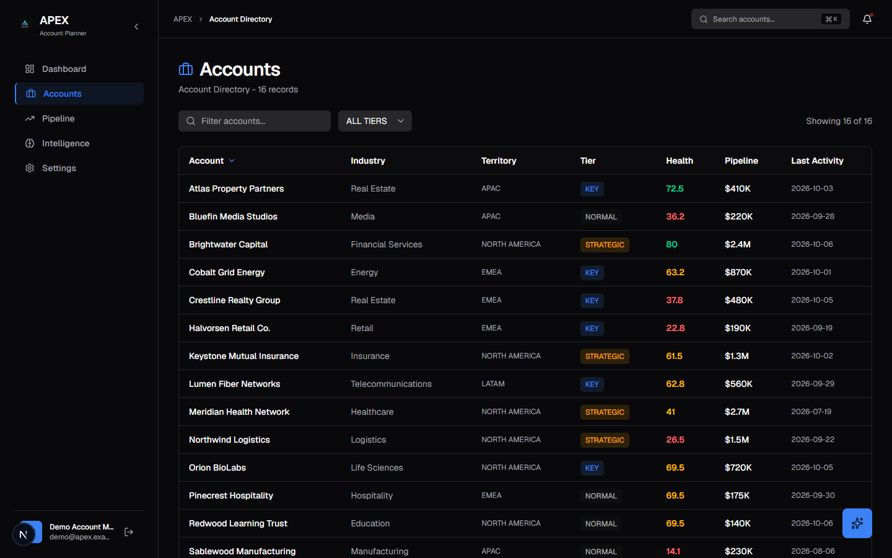
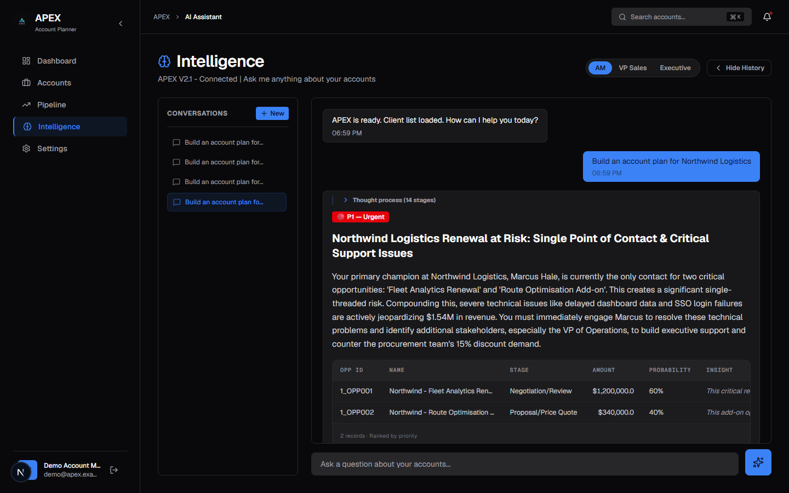
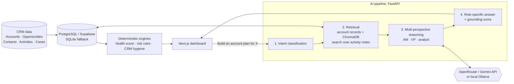

# APEX: AI Co-pilot for Account Planning

**APEX reads your CRM, tells you which accounts are about to slip and why, and writes the account plan to save them.**

Built by **[Dataosis AI](https://dataosis.in)** as a working reference for what we implement on Salesforce and Agentforce.

**Live demo: [account-planner-ten.vercel.app](https://account-planner-ten.vercel.app)**. Click **Log In**, then **Use demo account** (`demo@apex.example` / `ApexDemo#2026`).

> The demo runs on free hosting. Outside about 10:30–19:30 IST the first visit can take ~3 minutes while the server wakes up. Data questions (at-risk accounts, revenue, deals closing) answer in seconds; full AI account plans use free AI models and take a few minutes.



---

## The business problem

Renewals and expansions rarely die without warning. The signs are already in the CRM: a $1M deal with only one contact, an opportunity no one has touched in three months, a critical support case the customer's CFO is escalating. They're spread across Opportunities, Contacts, Activities and Cases, so nobody sees them until the deal slips.

## What APEX does

| | |
|---|---|
| **Account health score (0–100)** | Calculated for every account from pipeline vs. business won, contact coverage, engagement recency, deal progression and support quality. |
| **Automatic risk detection** | Flags single-threaded deals, stalled strategic accounts, deals past close date, open critical cases and low CSAT. These are deterministic rules, so you can see exactly why an account is flagged. |
| **One-click AI account plan** | Click a flagged account and APEX writes a plan grounded in that account's records: who to call, what's at stake and what to do this week. |
| **Answers for each role** | The same data is framed for an Account Manager, a VP of Sales or an executive. |
| **Grounding checks** | Each AI answer is scored against the CRM values it cites, and pipeline totals are itemised by a calculation auditor. |

| Accounts ranked by health | AI account plan for an at-risk account (one click from the dashboard) |
|---|---|
|  |  |

> All companies, people and numbers in the demo are fictional (see [`backend/demo_dataset.py`](backend/demo_dataset.py)).

---

## Run the demo (one command)

Requires [Docker Desktop](https://www.docker.com/products/docker-desktop/).

```bash
# Optional, enables AI account plans (dashboard and risk detection work without it)
echo "OPENROUTER_API_KEY=your_key_here" > .env

docker compose up --build
```

Open **http://localhost:3000**, click **Log In**, then **Use demo account** (`demo@apex.example` / `ApexDemo#2026`).

The first build downloads Python ML dependencies and takes several minutes. Later starts are fast.

> **Model:** AI calls go through [OpenRouter](https://openrouter.ai) using free models only: `nvidia/nemotron-3-super-120b-a12b:free`, falling back to Gemma 4 when it is busy (change with `OPENROUTER_MODEL` / `OPENROUTER_FALLBACK_MODELS`). An account plan uses about 12 model calls. OpenRouter's free tier allows 50 requests per day, roughly 4 AI plans; data questions (revenue, contacts, at-risk lists) use none.

---

## How it works



- **Backend:** Python, FastAPI, SQLAlchemy, pandas, ChromaDB, sentence-transformers (the hosted demo runs the same embedding model on FastEmbed to fit in 512 MB)
- **Frontend:** Next.js, React, TypeScript, Recharts, Framer Motion
- **Data:** PostgreSQL / Supabase with multi-tenant row-level isolation, SQLite fallback for local runs
- **AI:** any OpenRouter model (default: free Nemotron 3 Super with Gemma 4 fallbacks), Google Gemini directly, or Ollama (fully local, no data leaves your network)
- **Ops:** Docker Compose, GitHub Actions CI and keep-alive, eval harness and request tracing; hosted on Render (backend), Vercel (frontend) and Supabase (database)

More detail: [architecture docs](docs/architecture/README.md) · [case study](docs/CASE_STUDY.md)

---

## Use your own data

APEX loads the built-in demo dataset by default. To load a Salesforce-style Excel export instead (sheets: `Account`, `Opportunity`, `Contact`, `Activity`, `Case`), set `DATA_PATH=/path/to/export.xlsx` for the backend. The column format is shown in [`backend/demo_crm_data.xlsx`](backend/demo_crm_data.xlsx), which you can regenerate with `python backend/demo_dataset.py`. Early Salesforce and HubSpot API sync functions are in [`backend/sync_daemon.py`](backend/sync_daemon.py). They're untested against a live org.

## Local development (without Docker)

```bash
# Backend (http://localhost:8002)
cd backend
pip install -r requirements.txt
uvicorn main:app --reload --port 8002

# Frontend (http://localhost:3000), in a second terminal
cd frontend
npm install
BACKEND_URL=http://localhost:8002 AUTH_URL=http://localhost:8002 npm run dev
```

Without `DATABASE_URL` the backend uses a local SQLite file. Optional backend settings (environment variables or `backend/.env`): `OPENROUTER_API_KEY` / `OPENROUTER_MODEL`, `GEMINI_API_KEY`, `DATABASE_URL`, `LLM_URL` / `MODEL_NAME` for a local Ollama model.

---

## Want this on your Salesforce?

We implement this pattern inside your org, as Agentforce actions or a custom app on your real pipeline, with your own risk rules.

**Dataosis AI**: [dataosis.in](https://dataosis.in)

*Proprietary. All rights reserved.*
