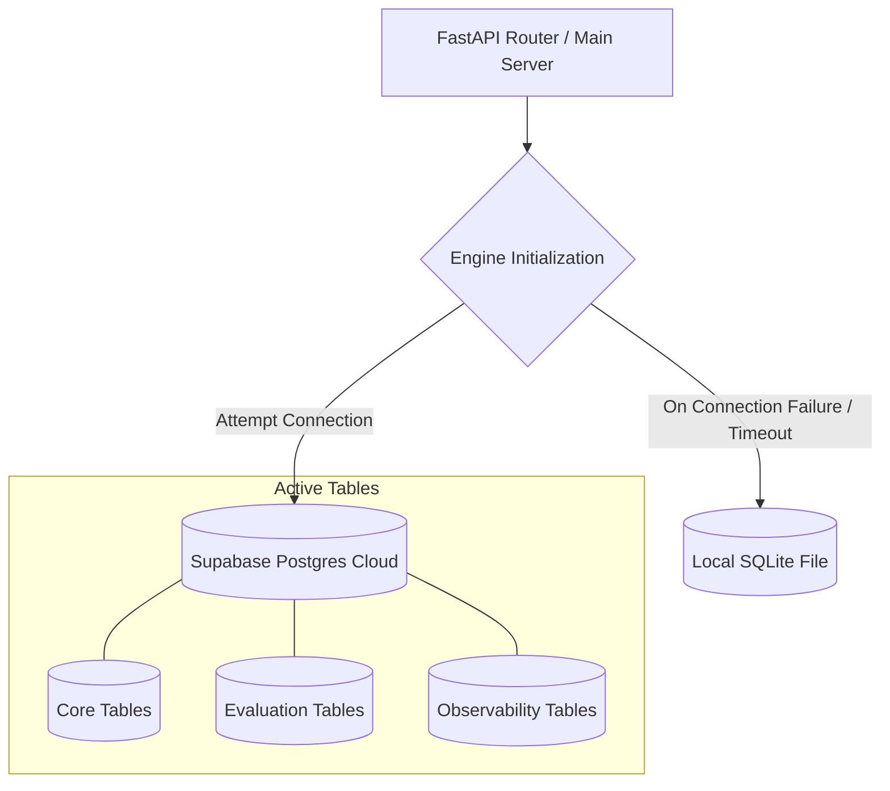

# APEX Account Planner — Database Architecture & Evolution Strategy

This document outlines the database topology, schema definitions, and scaling strategies for the APEX Account Planner, balancing rapid transactional capabilities with enterprise-grade evaluation and observability auditing.

---

## 1. Architectural Topology: Hybrid Database Isolation

The APEX database layers are built on a hybrid architecture designed for resilience and scalability.
- **Primary Database Engine:** Supabase-hosted PostgreSQL. It acts as the multi-tenant central repository for CRM records, user accounts, evaluation benchmarks, and observability telemetry.
- **Automatic Fallback Engine:** Embedded local **SQLite** (`local_planner.db`). If network latency spikes or a connection timeout is triggered when contacting Supabase, the application automatically falls back to the local SQLite database to prevent downtime.

### Database Connection and Fallback Flow

### Strategic Comparison: Cloud vs. Local Datastores

| Dimension | Primary: Supabase / Cloud Postgres | Fallback: Embedded SQLite |
| :--- | :--- | :--- |
| **Data Integrity & Pool** | **Excellent:** Multi-user support with pg_pre_ping connection pool. | **Medium:** Subject to write locks on high concurrency. |
| **Offline Performance** | **None:** Relies on cloud network availability. | **Excellent:** Fully functional without internet connectivity. |
| **Maintenance Overhead** | **Low:** Automated managed backups and schema updates. | **Low:** Self-contained file database within the Python runtime. |

---

## 2. Complete Database Schema Definitions

The database schema is organized into three main functional categories: **Core CRM & Chat**, **AI Evaluation Suite**, and **System Observability**.

### 2.1 Core CRM & User Tables
These tables hold the operational CRM entities scoped by `user_id` to enforce strict multi-tenancy logical isolation.

1. **`users`**
   - Houses tenant system accounts and encrypted authorization data.
   - *Columns:* `id` (PK), `name`, `email` (Unique), `hashed_password`, `created_at`.
2. **`accounts`**
   - Stores corporate accounts.
   - *Columns:* `Account_ID` (PK), `Account_Name`, `Account_Tier`, `Industry`, `Territory`, `Annual_Revenue_USD`, `Country`, `Health_Score`, `user_id` (FK -> users).
3. **`opportunities`**
   - Tracks deals associated with accounts.
   - *Columns:* `Opp_ID` (PK), `Account_ID` (FK), `Opp_Name`, `Amount_USD`, `Stage`, `Close_Date`, `Probability_Pct`, `Competitor`, `user_id` (FK).
4. **`contacts`**
   - Tracks personnel and stakeholders.
   - *Columns:* `Contact_ID` (PK), `Account_ID` (FK), `First_Name`, `Last_Name`, `Role`, `Department`, `Engagement_Level`, `Email`, `Phone`, `Last_Contact_Date`, `user_id` (FK).
5. **`cases`**
   - Support tickets or issues.
   - *Columns:* `Case_ID` (PK), `Account_ID` (FK), `Subject`, `Status`, `Severity`, `CSAT_Score`, `Open_Date`, `user_id` (FK).
6. **`activities`**
   - Interaction logs (calls, meetings, emails).
   - *Columns:* `Activity_ID` (PK), `Account_ID` (FK), `Contact_ID` (FK, Nullable), `Activity_Type`, `Type` (Compatibility field), `Description`, `Activity_Date`, `user_id` (FK).
7. **`chat_sessions`**
   - Persisted chat interfaces.
   - *Columns:* `id` (PK), `created_at`, `user_id` (FK).
8. **`chat_messages`**
   - Chat dialogue history.
   - *Columns:* `id` (PK), `session_id` (FK), `sender` ("user"/"assistant"), `text`, `timestamp`, `user_id` (FK).

### 2.2 AI Evaluation Suite
These tables support the golden dataset execution, prompt regression analysis, and human-in-the-loop review.

9. **`eval_golden_dataset`**
   - Holds ground-truth inputs and expectations for evaluating all 4 pipeline phases.
   - *Columns:* `id` (PK), `version`, `status`, `source`, `priority`, `tags` (JSON), `owner_id`, `query`, `user_context` (JSON), expectations per phase (Planner, Retriever, Reasoner, Narrator).
10. **`eval_runs`**
    - Tracks metric benchmark test runs.
    - *Columns:* `id` (PK), `run_type`, `trigger`, `status`, `model_name`, `model_version`, `prompt_versions` (JSON), `backend_git_commit`, `started_at`, `completed_at`, `created_by`.
11. **`eval_benchmark_results`**
    - Stores calculated evaluation metrics for a specific test run compared to the golden reference.
    - *Columns:* `id` (PK), `run_id` (FK), `golden_id` (FK), metrics (intent matches, retriever recall/precision, LLM-as-judge grounding scores, latency metrics).
12. **`eval_human_reviews`**
    - Captures manual overrides, qualitative accuracy, trust, and business usefulness ratings.
    - *Columns:* `id` (PK), `benchmark_result_id` (FK), `reviewer_id`, score metrics (accuracy, readability, actionability), review notes.
13. **`eval_failure_database`**
    - Logs automated/human-reported failures to assist regression triage.
    - *Columns:* `id` (PK), `trace_id`, `golden_id` (FK), `source`, `question`, `expected`, `actual`, `root_cause`, `severity`, `status`, `resolution`.
14. **`eval_release_history`**
    - Logs deployments of tested model configurations.
    - *Columns:* `id` (PK), `release_version`, `backend_git_commit`, `run_id` (FK), `status`, `deployed_at`.
15. **`eval_prompt_benchmarks` & `eval_model_benchmarks`**
    - Comparisons between different prompt versions and LLMs.
16. **`bis_records` & `bis_weight_config`**
    - Business Impact Score (BIS) configurations and evaluation logs.

### 2.3 System Observability
Telemetry layers tracking LLM performance, runtime tracing, and prompt templates.

17. **`apex_observability_prompts`**
    - Caches compiled system prompts by hash.
    - *Columns:* `prompt_hash` (PK), `prompt_version`, `prompt_template`, `created_at`.
18. **`apex_observability_traces`**
    - Tracks end-to-end user query cycles.
    - *Columns:* `id` (PK), `trace_id` (Unique), `request_id`, `session_id`, `user_id`, `user_query`, `final_response`, performance metrics (latencies, token costs).
19. **`apex_observability_spans`**
    - Tracks phase execution times (PLANNER, RETRIEVER, REASONER, NARRATOR).
    - *Columns:* `id` (PK), `trace_id` (FK), `stage_name`, `duration_ms`.
20. **`apex_observability_payloads`**
    - Persists exact inputs and outputs for debug replays.
    - *Columns:* `trace_id` (FK, PK), prompt hashes, final outputs, context summaries.
21. **`apex_observability_business_metrics`**
    - Estimates time saved and productivity metrics.

---

## 3. Advanced Roadmap: Database Evolution

1. **Automatic Schema Migrations (Alembic):** Maintain schema synchronization across developer environments and cloud instances.
2. **Read-Replica Routing:** Separate write operations (such as telemetry payloads and logs) from analytical read queries on active dashboards to ensure low latency.
3. **Partitioning Strategy:** Implement horizontal table partitioning on observability logs using range intervals (e.g., monthly tables) to maintain database indexing speed.
