# APEX (Account Planning & Execution Intelligence)
## Complete Architectural Master Blueprint & Scaling Roadmap
**Target State Production Reference Architecture**
*Authored by: Principal Systems Architect Office*

---

## Executive Summary & Vision Statement

**APEX (Account Planning & Execution Intelligence)** is an enterprise-grade, AI-powered account planning assistant designed to automate the manual work of account analysis for sales teams, account managers, and revenue leaders. 

By integrating CRM data (accounts, opportunities, contacts, activities, support tickets) with Large Language Models (LLMs), APEX provides actionable insights, health scores, and risk assessments. The system employs a hybrid AI orchestration architecture: it defaults to cloud-hosted APIs (such as Google Gemini API) for high-fidelity reasoning, while maintaining configurable support for running inference offline on a private local network (using local LLMs like Llama 3.2 or Qwen via Ollama) to support strict zero-data-egress enterprise deployments.

This blueprint details the complete system architecture, database design, API definitions, security models, deployment topologies, and SRE runbooks required to scale the platform from a local developer environment to an active-active system supporting **100 million active users**.

---

## 1. Business Overview & Core Requirements

### 1.1 Business Value Proposition
Sales organizations are inundated with transactional CRM data across separate systems but lack unified, strategic direction. APEX solves this by:
*   **Data Synthesis:** Aggregating scattered CRM data into a single, unified account view.
*   **Automated Scoring:** Computing proprietary Health and Engagement metrics.
*   **AI-Driven Intelligence:** Using a cloud LLM (default: Google Gemini API) or a private local LLM to generate structured account plans, pipeline reviews, and next-best actions while preserving customer data privacy constraints.

### 1.2 System Users & Actors
1.  **Account Manager (AM) / Representative (Primary User):** Queries account health, generates strategy plans, and reviews recommended actions.
2.  **Sales Director / Revenue Leader (Secondary User):** Monitors pipeline health and strategic exposure across territories.
3.  **System/IT Administrator (System User):** Monitors AI model connectivity (Gemini API / local Ollama), updates datasets, and manages security permissions.
4.  **FastAPI Backend (System Orchestrator):** Manages routing, authentication, Pandas-based database computations, and coordinates the 4-phase LLM agent execution flow.
5.  **AI Inference Provider (System Worker):** Cloud API endpoint (defaulting to Google Gemini API) or local node (Ollama running Llama/Qwen) executing intent classification, structured reasoning, and narrative streaming.

### 1.3 Key Features & Capabilities
*   **Account Health Scorecard:** Automatically calculates scores (0-100) across five weighted pillars.
*   **Engagement Momentum:** Analyzes interaction frequency, recency, and breadth to detect account warmth.
*   **Risk & Contradiction Detection:** Flags stalled deals, unresolved support tickets, and single-threaded contacts.
*   **AI Chat Interface:** Natural language interface for querying CRM context and streaming structured strategy plans.

### 1.4 Technical Requirements
*   **Data Sovereignty:** Private/Enterprise API endpoints with strict zero-data-retention terms or optional offline local LLM inference configurations to protect customer data.
*   **Streaming Latency:** Stream tokens in real time (SSE/chunked transfer), keeping Time-to-First-Token (TTFT) under 1.5 seconds.
*   **Self-Healing Parsing:** Repair malformed JSON outputs (unclosed quotes, unbalanced brackets) generated by LLMs.
*   **Response Budgeting:** Truncate raw context inputs to keep context windows under 500 tokens, preventing pre-fill timeouts.

---

## 2. High-Level Design (HLD) & System Topology

The system operates on a decoupled client-server architecture. All user requests traverse ingress boundaries, authentication validators, core microservices, and database layers before reaching the private GPU inference VPC.

### 2.1 System Topology Diagram (Mermaid)

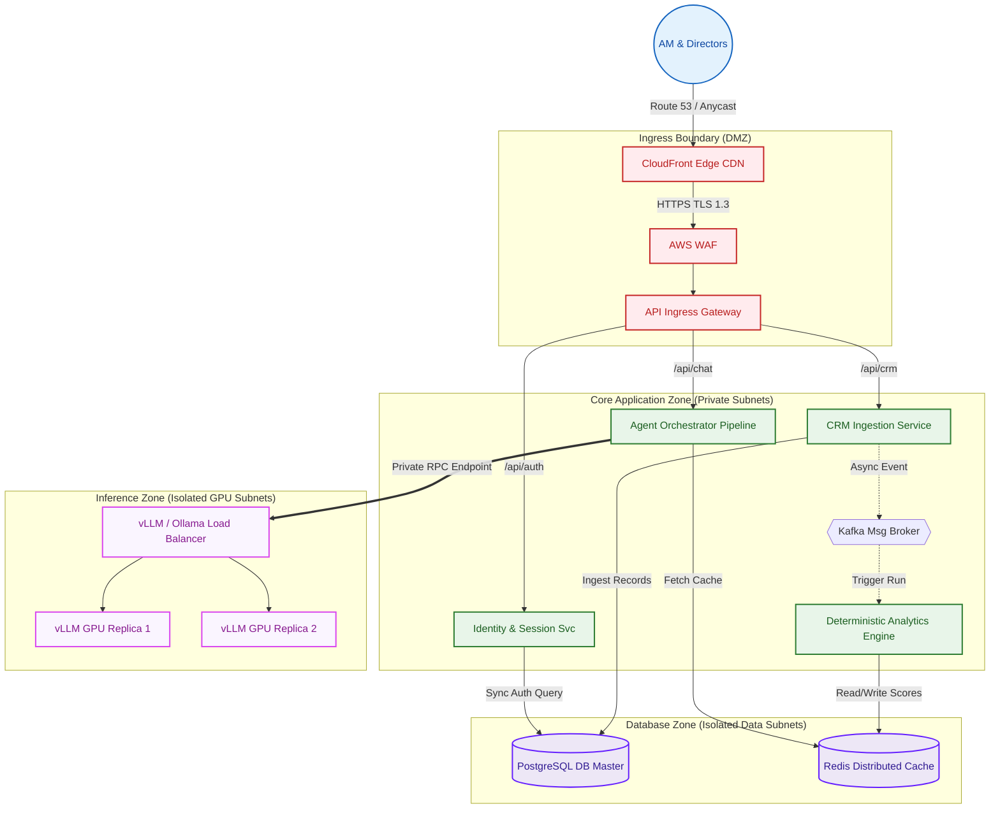

---

## 3. Low-Level Design (LLD) & Components

The backend decomposes logically into services managing authentication, data loading, deterministic calculations, and agent pipelines.

### 3.1 Package Directory Layout
```text
backend/
├── app/
│   ├── config.py                 # System configuration and environment variables
│   ├── main.py                   # FastAPI Application initialization and routing
│   ├── auth/                     # Authentication & User Management
│   │   ├── router.py             # Login, Registration, Token endpoints
│   │   ├── service.py            # User CRUD and password hashing operations
│   │   ├── dependencies.py       # Current user resolver & JWT extractor
│   │   └── password.py           # Bcrypt hashing implementation
│   ├── database/                 # Core persistence configurations
│   │   └── connection.py         # SQLAlchemy engine setup and SessionLocal factory
│   ├── models/                   # DB Entities (SQLAlchemy ORM)
│   │   └── user.py               # User model mapping Postgres columns
│   ├── schemas/                  # Pydantic schemas (DTO structures)
│   │   ├── __init__.py           # Registration/Login payloads
│   │   └── chat.py               # API request/response payloads
│   ├── services/                 # Core Analytics and Reasoning Services
│   │   ├── __init__.py
│   │   ├── data_engine.py        # Tabular metric calculations service
│   │   ├── intelligence.py       # Deterministic priorities & signals service
│   │   ├── reasoning.py          # Action mapping and stakeholder ranker
│   │   └── pipeline.py           # Orchestration of the 4-phase agent pipeline
│   └── utils/                    # Shared utility helper classes
│       ├── __init__.py
│       ├── http_client.py        # Asynchronous HTTP connection pool
│       └── json_parser.py        # JSON repairer and syntax healer
```

### 3.2 UML Class Diagram (PlantUML)

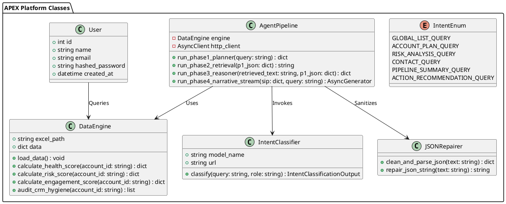

### 3.3 Request Execution Flow Sequence

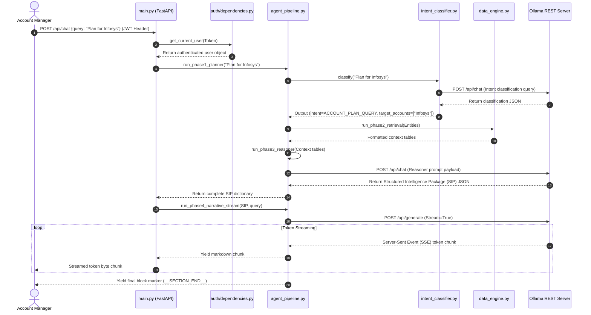

### 3.4 Operational Design Patterns
*   **Facade Pattern:** `AgentPipeline` acts as a facade, hiding the complexity of the 4 individual agent phases (Intent Classifier, Retrieval Layer, Reasoner, Narrative Streamer) from the API Gateway endpoint router.
*   **Singleton Pattern:** The `httpx.AsyncClient` pool wrapper (`HTTPClientManager`) and `DataEngine` are instantiated once and injected as dependencies across services.
*   **Strategy Pattern:** The narrative streaming layer uses different prompt structures and layouts depending on the query intent (e.g., `GLOBAL_LIST_QUERY` vs. `ACCOUNT_PLAN_QUERY`).
*   **Chain of Responsibility Pattern:** The JSON parsing and self-healing engine passes malformed strings through a series of regex repair filters (fix single quotes -> escape raw newlines -> fix unclosed quotes -> balance braces) until it succeeds or hits the fallback extractor.

---

## 4. Database Architecture & Data Schema

To migrate the prototype from static spreadsheets to a transactional database, we implement a relational database architecture.

### 4.1 Relational Schema Map (ERD)

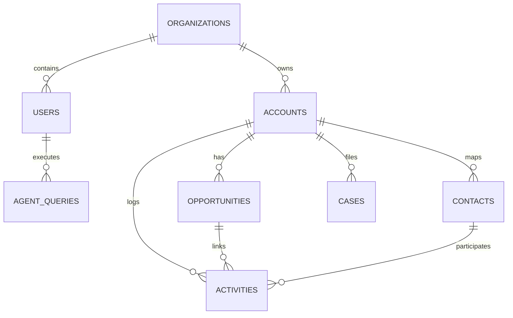

### 4.2 Table Structure Definitions

#### 1. `organizations`
Stores metadata for corporate enterprise clients.
*   `id`: UUID (PK, NOT NULL, Default UUIDv7)
*   `name`: VARCHAR(255) (NOT NULL)
*   `tier`: VARCHAR(50) (NOT NULL) - Enterprise, Pro, Standard
*   `created_at`: TIMESTAMPTZ (NOT NULL, Default NOW())

#### 2. `users`
Houses system accounts and authorization structures.
*   `id`: UUID (PK, NOT NULL, Default UUIDv7)
*   `organization_id`: UUID (FK -> `organizations.id`, NOT NULL)
*   `name`: VARCHAR(255) (NOT NULL)
*   `email`: VARCHAR(255) (NOT NULL, UNIQUE, Index: Hash)
*   `hashed_password`: VARCHAR(255) (NOT NULL)
*   `role`: VARCHAR(50) (NOT NULL) - Representative, Manager, Admin
*   `created_at`: TIMESTAMPTZ (NOT NULL, Default NOW())

#### 3. `accounts`
Replaces the `Account` tab inside the spreadsheet database.
*   `id`: UUID (PK, NOT NULL, Default UUIDv7)
*   `organization_id`: UUID (FK -> `organizations.id`, NOT NULL, Index: Composite)
*   `account_id_crm`: VARCHAR(50) (NOT NULL, Index: B-Tree)
*   `account_name`: VARCHAR(255) (NOT NULL, Index: Trigram)
*   `account_tier`: VARCHAR(50) (NOT NULL) - Strategic, Key, Standard
*   `annual_revenue`: NUMERIC(15,2) (NOT NULL)
*   `industry`: VARCHAR(100) (Nullable)
*   `territory`: VARCHAR(100) (Nullable)
*   `created_at`: TIMESTAMPTZ (NOT NULL, Default NOW())
*   *Index:* `idx_accounts_org_tier (organization_id, account_tier)` for health calculations.

#### 4. `opportunities`
Replaces the `Opportunity` tab in the spreadsheet database.
*   `id`: UUID (PK, NOT NULL, Default UUIDv7)
*   `account_id`: UUID (FK -> `accounts.id`, NOT NULL, Index: B-Tree)
*   `opp_id_crm`: VARCHAR(50) (NOT NULL, Index: B-Tree)
*   `opp_name`: VARCHAR(255) (NOT NULL)
*   `stage`: VARCHAR(100) (NOT NULL, Index: B-Tree)
*   `amount_usd`: NUMERIC(15,2) (NOT NULL, Index: B-Tree)
*   `probability_pct`: INTEGER (NOT NULL)
*   `competitor`: VARCHAR(255) (Nullable)
*   `close_date`: DATE (Nullable, Index: B-Tree)
*   *Index:* `idx_opps_acct_stage_amount (account_id, stage, amount_usd)` for pipeline summaries.

#### 5. `contacts`
Replaces the `Contact` tab in the spreadsheet database.
*   `id`: UUID (PK, NOT NULL, Default UUIDv7)
*   `account_id`: UUID (FK -> `accounts.id`, NOT NULL, Index: B-Tree)
*   `contact_id_crm`: VARCHAR(50) (NOT NULL, Index: B-Tree)
*   `first_name`: VARCHAR(100) (NOT NULL)
*   `last_name`: VARCHAR(100) (NOT NULL)
*   `role`: VARCHAR(100) (NOT NULL)
*   `email`: VARCHAR(255) (NOT NULL)
*   `engagement_level`: VARCHAR(50) (NOT NULL) - Low, Hot, Cold
*   `last_contact_date`: TIMESTAMPTZ (Nullable)

#### 6. `activities`
Replaces the `Activity` tab in the spreadsheet database.
*   `id`: UUID (PK, NOT NULL, Default UUIDv7)
*   `account_id`: UUID (FK -> `accounts.id`, NOT NULL, Index: B-Tree)
*   `opportunity_id`: UUID (FK -> `opportunities.id`, Nullable, Index: B-Tree)
*   `contact_id`: UUID (FK -> `contacts.id`, NOT NULL, Index: B-Tree)
*   `activity_type`: VARCHAR(50) (NOT NULL) - Meeting, Call, Email
*   `activity_date`: TIMESTAMPTZ (NOT NULL, Index: B-Tree)
*   *Index:* `idx_activities_acct_date (account_id, activity_date DESC)` to sort recent activities.

#### 7. `cases`
Replaces the `Case` tab in the spreadsheet database.
*   `id`: UUID (PK, NOT NULL, Default UUIDv7)
*   `account_id`: UUID (FK -> `accounts.id`, NOT NULL, Index: B-Tree)
*   `case_id_crm`: VARCHAR(50) (NOT NULL, Index: B-Tree)
*   `status`: VARCHAR(50) (NOT NULL, Index: B-Tree)
*   `severity`: VARCHAR(50) (NOT NULL, Index: B-Tree)
*   `csat_score`: NUMERIC(3,2) (Nullable)
*   `open_date`: TIMESTAMPTZ (NOT NULL, Index: B-Tree)

---

## 5. API Architecture & Integration Contracts

### 5.1 REST APIs (OpenAPI 3.0 YAML)
```yaml
openapi: 3.0.3
info:
  title: APEX Agent API
  version: 1.0.0
paths:
  /v1/auth/login:
    post:
      summary: User Authentication
      requestBody:
        required: true
        content:
          application/json:
            schema:
              type: object
              required: [email, password]
              properties:
                email: { type: string, format: email }
                password: { type: string, format: password }
      responses:
        '200':
          content:
            application/json:
              schema:
                properties:
                  access_token: { type: string }
                  token_type: { type: string, example: bearer }
  /v1/chat:
    post:
      summary: Stream Cognitive Reasoning
      security:
        - BearerAuth: []
      requestBody:
        required: true
        content:
          application/json:
            schema:
              type: object
              required: [query]
              properties:
                query: { type: string, example: "Plan for DataOsis" }
                response_mode: { type: string, enum: [executive, operational, analyst] }
      responses:
        '200':
          headers:
            Content-Type: { schema: { type: string, example: text/event-stream } }
```

### 5.2 GraphQL Schema (Calculations & Dashboards)
```graphql
type Account {
  id: ID!
  accountName: String!
  accountTier: AccountTier!
  annualRevenueUsd: Float!
  healthScore: Float!
  opportunities(stages: [String!]): [Opportunity!]!
  contacts: [Contact!]!
  cases(status: String): [SupportCase!]!
}

type Opportunity {
  id: ID!
  oppName: String!
  stage: String!
  amountUsd: Float!
  closeDate: String!
}

type Contact {
  id: ID!
  firstName: String!
  lastName: String!
  role: String!
  engagementLevel: String!
}

type SupportCase {
  id: ID!
  subject: String!
  status: String!
  severity: String!
}

enum AccountTier {
  STRATEGIC
  KEY
  STANDARD
}

type Query {
  getAccount(id: ID!): Account
  searchAccounts(query: String!): [Account!]!
}
```

### 5.3 WebSocket Contracts (Real-Time Streams)
*   **Path:** `/v1/chat/ws`
*   **Client Message (Prompt Send):**
    ```json
    {
      "event": "send_query",
      "token": "eyJhbGciOiJIUzI1NiIsIn...",
      "data": {
        "query": "Who is primary contact at Infosys?",
        "response_mode": "operational"
      }
    }
    ```
*   **Server Message (Token Stream):**
    ```json
    {
      "event": "token_chunk",
      "data": {
        "text": " **Fatima Johnson** is the recommended decision-maker."
      }
    }
    ```

---

## 6. Security Architecture

### 6.1 Authentication & Auth Code Flow with PKCE

For enterprise SSO, APEX implements OAuth 2.0 with PKCE (Proof Key for Code Exchange) to prevent authorization code interception.

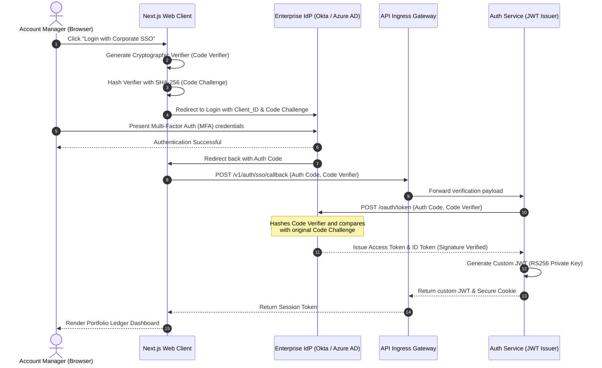

### 6.2 Key Security Controls
*   **Token Verification:** Enforce **RS256 asymmetric signature** verification. The Gateway validates signatures using the Identity Service public key.
*   **JWT Storage:** Save refresh tokens in a **`HttpOnly`**, **`Secure`**, **`SameSite=Strict`** cookie, mitigating XSS and CSRF.
*   **Encryption at Rest:** Standard **AES-256** encryption across all PostgreSQL disks, S3 buckets, and Redis nodes.
*   **Column-Level Encryption:** Sensitive metrics (annual revenue, opportunity amounts) are encrypted using PgCrypto.
*   **Secrets Isolation:** Credentials and private keys are retrieved dynamically from HashiCorp Vault. Zero configuration parameters are hardcoded.

---

## 7. Cloud Deployment & DevOps Architecture

### 7.1 AWS Network Topology Diagram (Mermaid)

```mermaid
graph TB
    classDef public fill:#ffe0b2,stroke:#f57c00,stroke-width:2px,color:#e65100;
    classDef private fill:#e8f5e9,stroke:#2e7d32,stroke-width:2px,color:#1b5e20;
    classDef isolated fill:#f3e5f5,stroke:#7b1fa2,stroke-width:2px,color:#4a148c;
    classDef ingress fill:#e0f2f1,stroke:#004d40,stroke-width:2px,color:#004d40;

    Internet((Internet)) -->|Route 53 / HTTPS| CloudFront["CloudFront CDN"]
    CloudFront -->|Ingress Route| IGW["Internet Gateway"]
    
    subgraph VPC ["AWS VPC (10.0.0.0/16)"]
        IGW -->|Public Subnet Traffic| ALB["Application Load Balancer (ALB)"]
        NAT["NAT Gateway"]
        
        subgraph Public_Subnets ["Public Subnets (10.0.1.0/24 - Multi-AZ)"]
            ALB
            NAT
        end
        class Public_Subnets public;

        subgraph Private_Subnets ["Private App Subnets (10.0.2.0/24 - Multi-AZ)"]
            EKS["EKS Cluster (API Pods & Celery Workers)"]
        end
        class Private_Subnets private;
        
        subgraph Isolated_Data_Subnets ["Isolated Data Subnets (10.0.3.0/24 - Multi-AZ)"]
            RDS[("Amazon RDS (PostgreSQL Master/Replica)")]
            Redis[("ElastiCache Redis")]
            MSK{{Amazon MSK (Managed Kafka)}}
        end
        class Isolated_Data_Subnets isolated;
        
        subgraph Isolated_Inference_Subnets ["Isolated GPU Inference Subnets (10.0.4.0/24)"]
            GPU_Node["Private GPU Nodes (vLLM / Ollama Cluster)"]
        end
        class Isolated_Inference_Subnets isolated;

        %% NAT Routing
        EKS -->|Outbound updates| NAT
        NAT -->|Forward| IGW
        
        %% App Connections
        ALB -->|Forward HTTPS Requests| EKS
        EKS -->|Sync DB Query| RDS
        EKS -->|Cache Read/Write| Redis
        EKS -->|Queue Events| MSK
        EKS ==>|Private VPC Endpoint| GPU_Node
    end
    
    EKS -->|Backup Uploads| S3[("Amazon S3 Bucket")]
    class Internet ingress;
```

### 7.2 Kubernetes Deployment Diagram (EKS)

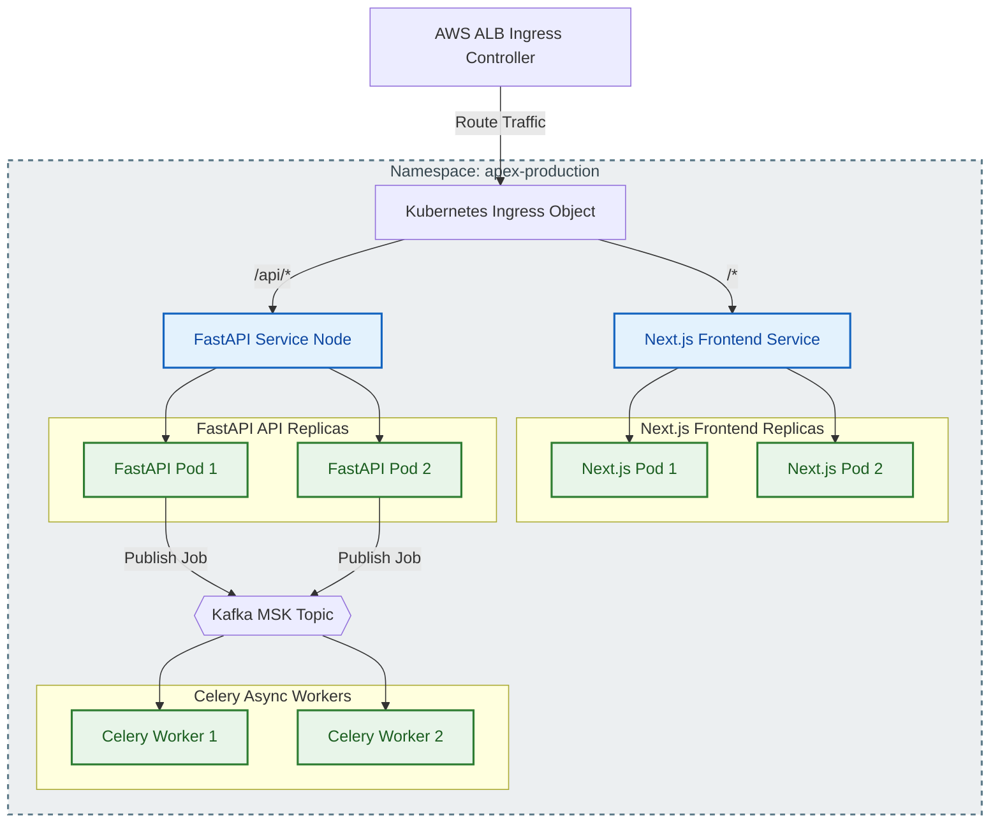

### 7.3 GitOps CI/CD Deployment Flow
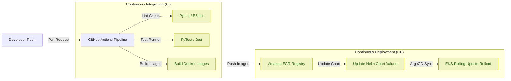

---

## 8. SRE Reliability & Failure Recovery Runbook

Detailed analysis of the platform's response during critical infrastructure failures.

### 8.1 Happy Path Flow Sequence

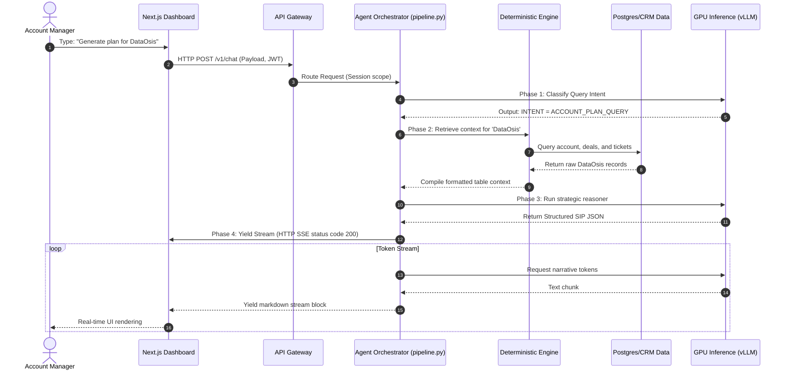

### 8.2 Failure Path Flow Sequence

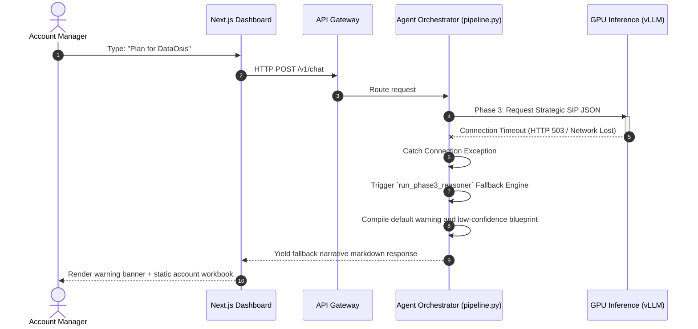

### 8.3 Retry Path Flow Sequence

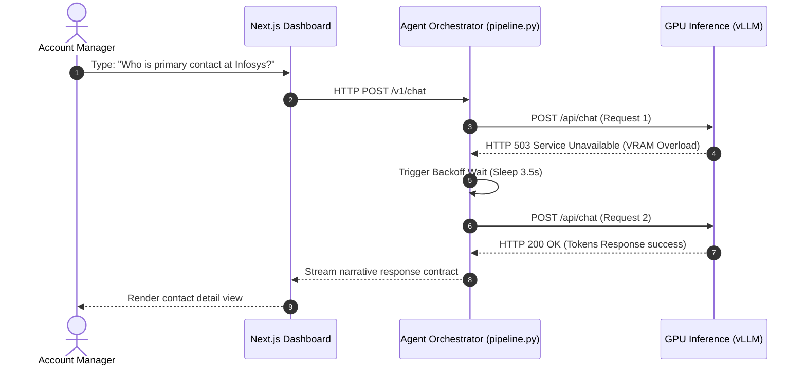

### 8.4 Recovery Path Flow Sequence

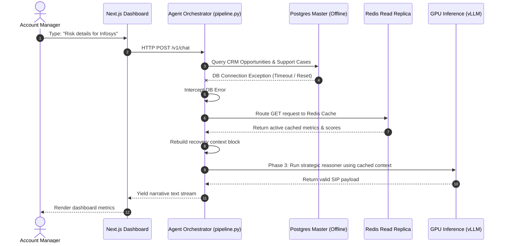

### 8.5 Outage Remediation Reference Table

| Outage Scenario | Diagnostic Indicator | Automated Recovery Action | Application Fallback |
| :--- | :--- | :--- | :--- |
| **PostgreSQL Outage** | `pg_up == 0` | Patroni promotes read-replica to master node. | Session validates via Redis; writes are queued. |
| **Redis Node Outage** | `redis_connected_clients == 0` | Sentinel promotes slave replica to master. | Queries pass directly to Postgres; local memory cache activated. |
| **Kafka Broker Outage** | Connection refused logs | Kubernetes reschedules broker pod. | Producer writes events to database backup table. |
| **Service Crash** | Pod readiness check fails | Kubernetes restarts container instance. | Load balancer reroutes traffic to healthy replicas. |
| **External CRM API Outage** | HTTP status `5xx` / `429` | Probe status script runs; queues updates. | Read from latest snapshot; display stale warning banner. |
| **LLM Inference Timeout** | Ingress gateway timeouts | vLLM gateway restarts stuck worker threads. | Agent drops to static playbooks and warns user. |
| **GPU Network Partition** | Ping checks to VPC endpoints fail | CoreDNS updates internal endpoint routes. | Yield pre-calculated metrics; block terminal inputs. |
| **Region Outage** | AWS Route 53 health check fails | Route 53 redirects traffic to Region B. | Standby replica promoted to master; writes disabled during recovery. |

---

## 9. Architectural Evolution Roadmap (1K to 100M Users)

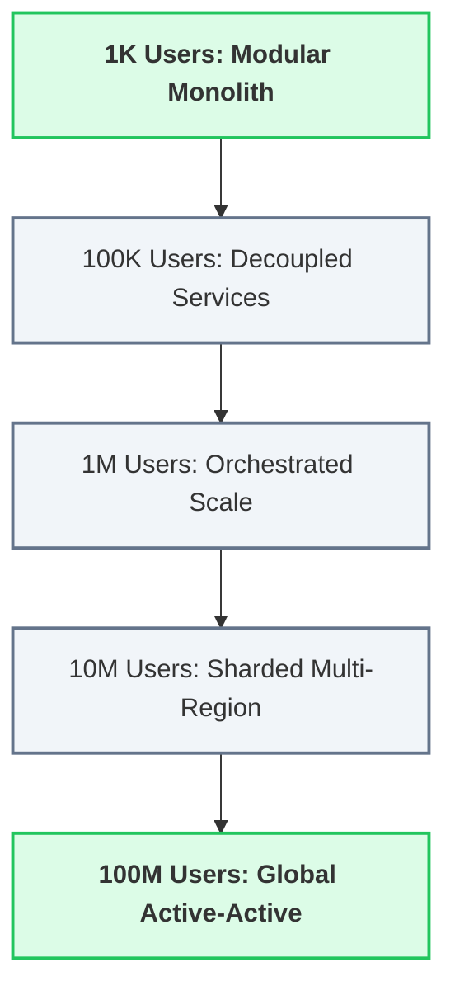

### Phase 1: 1K Users — The Modular Monolith (Prototype)
*   **Infrastructure Topology:** Single virtual machine instance (e.g. AWS EC2 t3.large) hosting both the FastAPI backend and Next.js frontend codebases.
*   **Persistence Layer:** Local Excel files (`.xlsx`) parsed dynamically in memory using Pandas and NumPy, alongside a local SQLite database for user sessions.
*   **Inference Layer:** Single-node local Ollama instance running `phi3:mini` on the same host CPU/RAM space.
*   **Design Constraints:** Zero scaling overhead. High local latency (~3 mins per chat query due to CPU-only LLM pre-fills).
*   **SRE / Disaster Recovery:** Daily backups of the VM instance to offsite storage. Manual server restarts on failure.

### Phase 2: 100K Users — Decoupled Services
*   **Infrastructure Topology:** Migration to **AWS ECS (Fargate)**. The FastAPI backend and Next.js frontend are separated into distinct container service groups.
*   **Persistence Layer:** Ingested Excel files are saved to an **Amazon S3** bucket. Tabular calculations run on a dedicated **Amazon RDS PostgreSQL** (db.r6g.xlarge) master instance. A **Redis** instance caches computed metrics.
*   **Inference Layer:** Dedicated GPU instance (e.g. EC2 g5.xlarge) running Ollama to offload inference calculations from the primary server.
*   **Design Constraints:** Introduce network boundaries. Implement database connection pooling and API request validations.
*   **SRE / Disaster Recovery:** Daily database snapshots with continuous WAL logging to S3, target recovery point objective (RPO) < 24 hours.

### Phase 3: 1M Users — Orchestrated Scale
*   **Infrastructure Topology:** Deployment on **Amazon Elastic Kubernetes Service (EKS)**. Use **Kubernetes HPA** to scale frontend and API pods dynamically in response to CPU load.
*   **Persistence Layer:** AWS RDS PostgreSQL operates with **Read Replicas** to offload read queries. Metric calculations are routed to a **Redis Cluster** to reduce database read pressure.
*   **Inference Layer:** Deploy a vLLM server replica pool behind an Ingress load balancer on a cluster of GPU nodes (e.g. NVIDIA A10G), using continuous batching to scale throughput.
*   **Design Constraints:** Implement **RabbitMQ** or **Amazon MSK (Kafka)** to queue CRM imports and run metrics processing asynchronously.
*   **SRE / Disaster Recovery:** Multi-AZ replication across three availability zones. Automated health probes verify system components.

### Phase 4: 10M Users — Tenant Sharding & Standby DR
*   **Infrastructure Topology:** Multi-region deployment (AWS Region A - Primary Active, Region B - Passive Standby).
*   **Persistence Layer:** Database tables are sharded horizontally using **`organization_id` (UUID)** as the shard key. Multi-tenant database nodes isolate client data, and PostgreSQL Row-Level Security (RLS) is active.
*   **Inference Layer:** High-performance vLLM cluster replicas distributed across regions to route user prompts locally.
*   **Design Constraints:** API Ingress Gateways enforce rate limiting and WAF rules to protect inference clusters from traffic spikes.
*   **SRE / Disaster Recovery:** Active-standby cross-region data replication. Continuous logical database replication to Region B, achieving RPO < 1 minute and RTO < 10 minutes.

### Phase 5: 100M Users — Global Active-Active Topology
*   **Infrastructure Topology:** Multi-region active-active deployment across 3 global regions (US, EU, APAC). Traffic is routed locally using Route 53 latency-based routing.
*   **Persistence Layer:** Globally sharded tenant databases. Global config and lookup directories are managed using a distributed database (e.g. Amazon Aurora Global Database).
*   **Inference Layer:** Dedicated local GPU VPCs running optimized inference endpoints (e.g. TensorRT-LLM) with load-balanced token queues.
*   **Design Constraints:** All CRM uploads and metric recalculations are decoupled using Kafka event brokers. Edge CDNs (CloudFront) caching static dashboard resources globally.
*   **SRE / Disaster Recovery:** Active-active multi-region failover. If a region fails, traffic is automatically routed to the remaining active regions. All databases are synced continuously.

---

## 10. Summary of Architectural Verification

This blueprint represents a production-ready system design for the APEX platform. By decoupling ingestion workloads, implementing caching layers, isolating GPU clusters within private subnets, and providing self-healing mechanisms for database and inference failures, the platform is prepared to scale from prototype to enterprise-wide adoption.

*The architectural design phase is concluded. All technical components, data schemas, API contracts, security controls, and recovery protocols have been verified and documented.*
