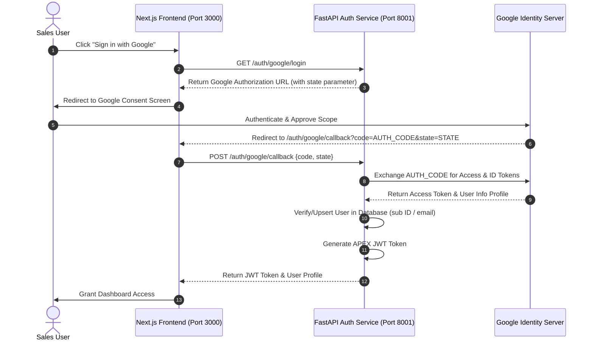

# 🚀 Upcoming Plans — 24 July: Google OAuth2 Integration Guide

This document outlines the architectural blueprint, API routes, database changes, and frontend modifications required to add **"Sign in with Google"** to the APEX Account Planner ecosystem.

---

## 🗺️ Architectural Flow

We will implement the standard **OAuth 2.0 Authorization Code Flow** with security hardening (state tokens to prevent CSRF):



---

## 🛠️ Step 1: Google Cloud Console Setup

1. **Create Project**: Go to the [Google Cloud Console](https://console.cloud.google.com/) and create a new project called `APEX-Account-Planner`.
2. **OAuth Consent Screen**:
   - Set User Type to **External**.
   - App Name: `APEX Account Planner`.
   - Scopes: Add `.../auth/userinfo.email` and `.../auth/userinfo.profile`.
3. **Credentials**:
   - Click **Create Credentials** -> **OAuth Client ID**.
   - Application Type: **Web Application**.
   - Authorized JavaScript Origins: `http://localhost:3000`
   - Authorized Redirect URIs: `http://localhost:3000/auth/google/callback` (or your backend callback address `http://localhost:8001/auth/google/callback`).
4. **Secrets**: Copy the generated **Client ID** and **Client Secret** and add them to your environment variables:
   ```env
   GOOGLE_CLIENT_ID=your-client-id.apps.googleusercontent.com
   GOOGLE_CLIENT_SECRET=your-client-secret
   GOOGLE_REDIRECT_URI=http://localhost:3000/auth/google/callback
   ```

---

## 💾 Step 2: Database Schema Upgrades

We must alter the `users` table to support OAuth logins (passwords will be nullable for Google-only users, and we will track Google's unique `sub` identifiers):

#### Migration Script (`backend/migrations/oauth_setup.sql`):
```sql
ALTER TABLE users ADD COLUMN IF NOT EXISTS google_id VARCHAR(255) UNIQUE;
ALTER TABLE users ADD COLUMN IF NOT EXISTS profile_pic VARCHAR(500);
ALTER TABLE users ALTER COLUMN hashed_password DROP NOT NULL;
```

#### SQLAlchemy Model Update (`backend/models/user.py`):
```python
# In models/user.py
class User(Base):
    __tablename__ = "users"
    
    id = Column(Integer, primary_key=True, index=True)
    name = Column(String, nullable=False)
    email = Column(String, unique=True, index=True, nullable=False)
    hashed_password = Column(String, nullable=True) # Password nullable for OAuth-only users
    google_id = Column(String, unique=True, nullable=True) # Unique Google Subject ID
    profile_pic = Column(String, nullable=True)
    role = Column(String, default="account_manager")
```

---

## ⚙️ Step 3: Backend FastAPI Implementation

We will add a dedicated Google OAuth service router in the auth microservice.

#### 1. Add Dependencies:
Ensure `httpx` is in your requirements or system environment.

#### 2. Implement Router (`backend/auth/google_router.py`):
```python
import os
import httpx
from fastapi import APIRouter, Depends, HTTPException, status
from sqlalchemy.orm import Session
from database import get_db
from auth.service import create_access_token # reuse token signing helper
from models.user import User

router = APIRouter(prefix="/auth/google", tags=["Google OAuth"])

GOOGLE_CLIENT_ID = os.getenv("GOOGLE_CLIENT_ID")
GOOGLE_CLIENT_SECRET = os.getenv("GOOGLE_CLIENT_SECRET")
GOOGLE_REDIRECT_URI = os.getenv("GOOGLE_REDIRECT_URI")

@router.get("/login")
def get_google_login_url():
    """Generates the authorization redirect URL for Google consent screens."""
    auth_url = (
        f"https://accounts.google.com/o/oauth2/v2/auth?"
        f"response_type=code&"
        f"client_id={GOOGLE_CLIENT_ID}&"
        f"redirect_uri={GOOGLE_REDIRECT_URI}&"
        f"scope=openid%20email%20profile&"
        f"access_type=offline&"
        f"prompt=consent"
    )
    return {"url": auth_url}

@router.post("/callback")
async def google_callback(payload: dict, db: Session = Depends(get_db)):
    """Exchanges code for Google user details and signs a native APEX JWT."""
    code = payload.get("code")
    if not code:
        raise HTTPException(status_code=400, detail="Missing authorization code")

    # 1. Exchange auth code for tokens
    async with httpx.AsyncClient() as client:
        token_response = await client.post(
            "https://oauth2.googleapis.com/token",
            data={
                "client_id": GOOGLE_CLIENT_ID,
                "client_secret": GOOGLE_CLIENT_SECRET,
                "code": code,
                "redirect_uri": GOOGLE_REDIRECT_URI,
                "grant_type": "authorization_code",
            }
        )
        if token_response.status_code != 200:
            raise HTTPException(status_code=400, detail="Failed to retrieve Google tokens")
        
        tokens = token_response.json()
        access_token = tokens.get("access_token")

        # 2. Get user info using access token
        user_info_response = await client.get(
            "https://www.googleapis.com/oauth2/v3/userinfo",
            headers={"Authorization": f"Bearer {access_token}"}
        )
        if user_info_response.status_code != 200:
            raise HTTPException(status_code=400, detail="Failed to retrieve Google user profile")
        
        user_info = user_info_response.json()
    
    email = user_info.get("email")
    google_id = user_info.get("sub")
    name = user_info.get("name", "Google User")
    picture = user_info.get("picture")

    # 3. Check / Upsert User in DB
    user = db.query(User).filter((User.google_id == google_id) | (User.email == email)).first()
    if not user:
        user = User(
            email=email,
            name=name,
            google_id=google_id,
            profile_pic=picture,
            role="account_manager"
        )
        db.add(user)
        db.commit()
        db.refresh(user)
    elif not user.google_id:
        # User signed up previously with password, link their Google account
        user.google_id = google_id
        user.profile_pic = picture
        db.commit()

    # 4. Generate local APEX access token
    apex_token = create_access_token(data={"sub": user.email, "user_id": user.id})
    return {
        "access_token": apex_token,
        "token_type": "bearer",
        "user": {
            "id": user.id,
            "name": user.name,
            "email": user.email,
            "profile_pic": user.profile_pic,
            "role": user.role
        }
    }
```

Make sure to mount this router in `backend/auth_main.py`:
```python
from auth.google_router import router as google_router
app.include_router(google_router)
```

---

## 🎨 Step 4: Frontend Next.js Implementation

#### 1. Add Google Sign In Button (`frontend/src/components/auth-page.tsx`):
Insert a polished "Sign in with Google" button below the standard email forms:
```tsx
// In auth-page.tsx
const handleGoogleLogin = async () => {
  try {
    const res = await fetch('/auth/google/login');
    const data = await res.json();
    if (data.url) {
      window.location.href = data.url; // Redirect client to Google Consent screen
    }
  } catch (err) {
    toast.error("Failed to initialize Google authentication flow.");
  }
};

// Render addition:
<button
  onClick={handleGoogleLogin}
  type="button"
  className="w-full flex items-center justify-center gap-2 px-4 py-2 border border-border/80 rounded-md bg-zinc-900/50 hover:bg-zinc-800 text-foreground transition-all"
>
  <svg className="w-5 h-5" viewBox="0 0 24 24">
    <path fill="currentColor" d="M12.24 10.285V13.4h6.887C18.2 15.614 15.645 18 12.24 18c-3.86 0-7-3.14-7-7s3.14-7 7-7c1.705 0 3.26.6 4.475 1.587l2.45-2.45C17.435 1.63 14.985 1 12.24 1 6.575 1 2 5.575 2 11.24s4.575 10.24 10.24 10.24c5.795 0 10.24-4.11 10.24-10.24 0-.69-.08-1.355-.22-1.955H12.24z"/>
  </svg>
  Continue with Google
</button>
```

#### 2. Create Callback Route (`frontend/src/app/auth/google/callback/page.tsx`):
This route catches the redirect parameters, contacts the backend to trade the code for an APEX token, and logs the user in.
```tsx
'use client'

import { useEffect } from 'react'
import { useRouter, useSearchParams } from 'next/navigation'
import { useAuth } from '@/context/AuthContext'
import { toast } from 'sonner'

export default function GoogleCallbackPage() {
  const router = useRouter()
  const searchParams = useSearchParams()
  const { loginWithToken } = useAuth() // Requires exposing a token login utility in context

  useEffect(() => {
    const code = searchParams.get('code')
    if (!code) {
      toast.error("Google authentication code missing.")
      router.push('/login')
      return
    }

    const exchangeCode = async () => {
      try {
        const response = await fetch('/auth/google/callback', {
          method: 'POST',
          headers: { 'Content-Type': 'application/json' },
          body: JSON.stringify({ code })
        })
        if (!response.ok) throw new Error("Callback exchange failed")
        
        const data = await response.json()
        await loginWithToken(data.access_token, data.user)
        toast.success("Welcome back! Google login successful.")
        router.push('/dashboard')
      } catch (err) {
        toast.error("Failed to complete Google login.")
        router.push('/login')
      }
    }

    exchangeCode()
  }, [searchParams])

  return (
    <div className="min-h-screen flex items-center justify-center bg-background">
      <div className="flex flex-col items-center gap-4 text-muted-foreground">
        <div className="w-8 h-8 border-2 border-primary/30 border-t-primary rounded-full animate-spin" />
        <p>Authenticating your account with Google...</p>
      </div>
    </div>
  )
}
```
