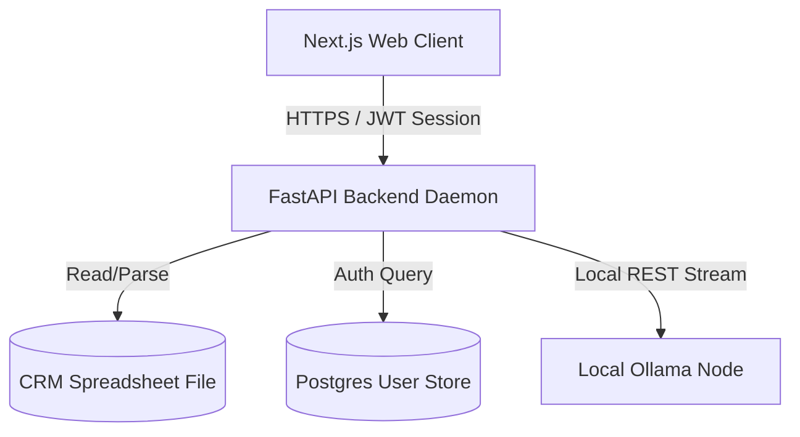
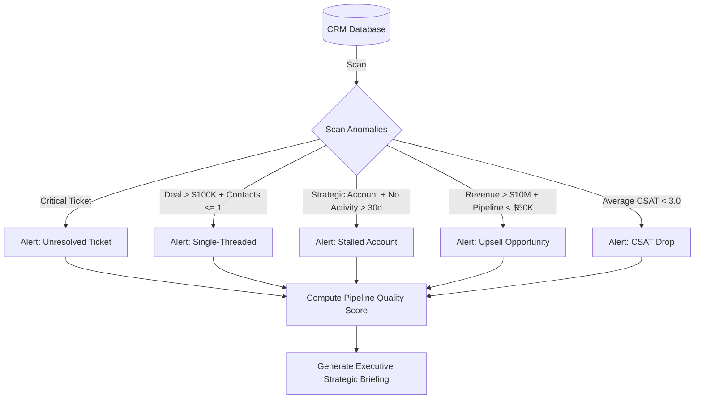

# APEX — Account Planning & Execution Intelligence: Project Explanation Playbook
**Technical & Architectural Documentation**

---

## 1. Project Overview

**APEX (Account Planner)** is a B2B sales-enablement co-pilot designed to automate portfolio analysis, pipeline tracking, and strategic account planning. Sales teams frequently suffer from "CRM blindness"—they are inundated with raw data but lack actionable directions. APEX bridges this gap by combining deterministic data calculations with Large Language Models (LLMs) to act as a digital account strategist.

### Key Value Propositions
*   **Decoupled Analytics:** Calculates metrics (Account Health, Engagement Momentum, Risk Score) deterministically using Python, freeing the LLM from executing math.
*   **Offline Data Sovereignty:** Directs LLM prompts to a local inference node (Ollama running private models like Llama 3.2 3B or Phi-3 Mini), ensuring zero financial or PII egress to public cloud providers.
*   **Structured Prescriptions:** Rather than rendering generic suggestions (e.g. "follow up soon"), APEX prescribes concrete, evidence-backed next best actions, naming contacts, metrics, and exact timelines.

---

## 2. Decoupled Client-Server Architecture

The platform operates on a decoupled client-server architecture containing four primary nodes:



1.  **Frontend Presentation (Client):** Next.js 15 Single Page Application (React 19) rendering the data grid, KPI charts, and chat interfaces.
2.  **API Gateway & Router (Backend Server):** FastAPI application hosting CORS configs, JWT validations, REST endpoints, and SSE streams.
3.  **Data Engine (Calculations):** Pure-Python module (Pandas/NumPy) reading CRM Excel sheets, calculating metrics, and auditing database hygiene.
4.  **AI Inference Node (Local LLM):** Local Ollama server executing NLP intent categorization, structured JSON reasoning, and narrative outputs.

---

## 3. Data Schema & Ingestion Layer

The core database consists of an Excel spreadsheet (`SF_AccountingAgent_DummyData.xlsx`) containing five standard CRM sheets loaded at system startup:
*   **Account:** Profiles annual revenue, territory mapping, industry, and account tier (Strategic, Key, Standard).
*   **Opportunity:** Logs pipeline data, deal stages, probability, amounts, expected close dates, and competitors.
*   **Contact:** Lists stakeholders, role mappings (Decision Maker, C-Suite, VP), and engagement level (Hot, Warm, Cold).
*   **Activity:** Logs logged calls, emails, meetings, and dates.
*   **Case:** Tracks customer support tickets, status, severity, and CSAT scores.

---

## 4. Backend Components Deep-Dive (`/backend`)

The backend is built with Python, using FastAPI for web routes and Pandas for in-memory calculations.

### 4.1 In-Memory Analytics Core (`data_engine.py`)
Computes metrics to supply "pre-reasoned" facts to the AI reasoning engine:
*   **Health Scorecard:** Calculates a 0-100 score based on:
    *   *Revenue Health (25%):* Active open pipeline relative to target account revenue.
    *   *Relationship Depth (20%):* Count of mapped contacts, check for decision-maker mapping.
    *   *Engagement Momentum (25%):* Recency, frequency, and breadth of activity interactions.
    *   *Deal Progression (20%):* Advanced pipeline stages (Proposal, Negotiation).
    *   *Support & Satisfaction (10%):* Unresolved critical support tickets and CSAT scores.
*   **Engagement Scoring:** Evaluates interaction recency, frequency (activities in the last 30 days), breadth (contacts mapped), and seniority (C-Suite involvement) to classify engagement as *🔥 Highly Engaged*, *💬 Moderately Engaged*, *🌡️ Low Engagement*, or *🧊 Cold*.
*   **Risk Analysis:** Flags accounts with high risk scores based on:
    *   No activities logged on Key/Strategic accounts in > 45 days.
    *   Unresolved critical support cases.
    *   Deals > $500K past expected close date.
    *   Decision-maker engagement classified as Low/Cold while in Negotiation stage.
*   **CRM Hygiene Auditing:** Scans for missing fields (close dates, competitors, single-threaded contacts) and downgrades query confidence to `LOW` when data is incomplete.

### 4.2 Strategic Intelligence Layer (`intelligence_layer.py`)
Provides deterministic rules without model dependencies, injecting hard prompt constraints:
*   **Signal Classifier:** Classifies and prioritizes data signals (Revenue > Pipeline > Strategic > Risk > Engagement > Temporal > CRM).
*   **Contradiction Detector:** Identifies logical discrepancies in CRM data (e.g. high-probability deals with zero activities, imminent close dates with zero contact).
*   **Why-This-Matters Engine:** Generates short business implications derived from metrics, establishing context for the LLM.

### 4.3 Multi-Layer Agent Pipeline (`agent_pipeline.py`)
Orchestrates request processing through four distinct phases:
*   **Phase 1 (Planner):** Parses user queries into structured intents (`IntentEnum`) and targets via [intent_classifier.py](file:///e:/Account%20Planner/backend/intent_classifier.py).
*   **Phase 2 (Retrieval):** Calls [data_retrieval_layer.py](file:///e:/Account%20Planner/backend/data_retrieval_layer.py) to extract relevant CRM rows and prune prompts, keeping context windows under 500 tokens.
*   **Phase 3 (Reasoner):** Calls the local LLM to execute parallel reasoning threads (Account Manager, VP, SVP, Data threads) and compile a structured JSON *Structured Intelligence Package (SIP)*. Features a self-healing parser to repair malformed outputs.
*   **Phase 4 (Narrative Streamer):** Streams the response to the client using predefined `__SECTION_*__` markup envelopes via [section_mapper.py](file:///e:/Account%20Planner/backend/section_mapper.py).

### 4.4 Ingress Gatekeeper (`main.py` & `auth`)
*   **Auth Services:** Standard User database model (`users` table) in PostgreSQL, verifying credentials and managing access.
*   **JWT Security:** Generates asymmetric tokens on login. Downstream routes verify signatures and check user session validity.
*   **API Gateways:** Enforces CORS limits and handles connection pools for the Ollama node.

---

## 5. Advanced Proactive Insights Engine

The API exposes a proactive insights service (`GET /api/insights`) that monitors the CRM database for anomalies, updates metrics, and alerts users:



---

## 6. Frontend Components Deep-Dive (`/frontend`)

The frontend is a single-page Next.js dashboard configured for real-time streaming:
*   **State Provider (`DataContext.tsx`):** Coordinates global client state. Fetches enriched accounts at startup, tracks the selected account, and updates system connection statuses.
*   **`PortfolioLedger.tsx`:** Renders the master account list, tier badges (🟢 Healthy, 🔴 Critical), and revenue summaries.
*   **`AccountDetail.tsx`:** Displays detailed metrics, contact directories, support history, and KPI charts (Recharts).
*   **`ProactiveInsights.tsx`:** Renders the insights panel, displaying alerts, suggestions, and the pipeline quality score.
*   **`ChatTerminal.tsx`:** Displays the chat interface, sending prompts to `/api/chat` and parsing streaming markdown sections in real time.

---

## 7. Running the Ecosystem

### Prerequisites
1.  **Ollama Node:** Install [Ollama](https://ollama.ai/). Pull the model:
    ```bash
    ollama pull llama3.2:latest
    ```
    Ensure the Ollama process is running in the background.

2.  **PostgreSQL Instance:** Ensure a PostgreSQL instance is running with a database named `account_planner` (default credentials: `postgres:postgres@localhost:5432`).

### Running the Services

#### 1. Start Backend Server
Navigate to `/backend`, configure environment variables in `.env`, and start the API gateway:
```bash
cd backend
poetry install
poetry run uvicorn main:app --reload --port 8002
```
*Verify gateway status at `http://localhost:8002/`.*

#### 2. Start Frontend Server
Navigate to `/frontend`, install dependencies, and start the development server:
```bash
cd frontend
npm install
npm run dev
```
*Access the application dashboard at `http://localhost:3000`.*
