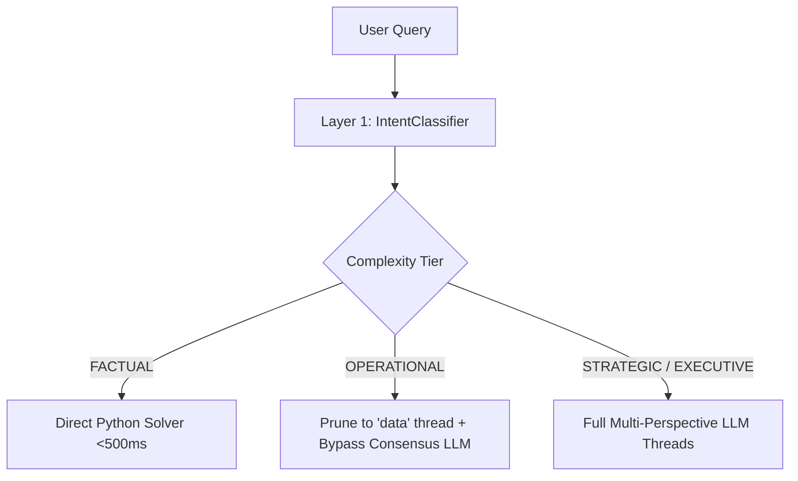

# APEX Systems Architecture & Debugging Report
**Session Date**: June 12, 2026

This document provides a detailed, comprehensive summary of the entire engineering session—tracking all milestones, issues identified, root causes analyzed, and resolutions implemented.

---

## 1. System Infrastructure & Setup

### Local LLM Fitment & RAM Management
* **Context**: Optimizing model operations on 8GB/16GB RAM devices.
* **Details**: Analyzed how `gemma2:2b` (approx. 1.6GB VRAM) and `qwen2.5:3b` fit within resource-constrained environments. Recommended sequential execution patterns for local Ollama instances to avoid concurrent thread thrashing, which leads to timeouts and memory spikes.

### Auth Server & Database Connectivity Patches
* **Port Alignment**: Configured the authentication server (`port 8002`) to launch automatically inside `run.bat` alongside the main backend and frontend endpoints to enable login capabilities.
* **Special Character URL Encoding**: Fixed connection failures in PostgreSQL `DATABASE_URL` by URL-encoding passwords containing special characters (e.g., escaping `@` as `%40`).
* **Database Auto-Initialization**: Added `Base.metadata.create_all(bind=engine)` directly inside the FastAPI startup routine in [main.py](file:///e:/Account%20Planner/backend/main.py) to automatically create tables like `users` upon launching the project.

---

## 2. UI Resiliency Upgrades

### Auth Validation Crash Mitigation
* **Issue**: FastAPI returns validation failures (such as password strength or email syntax errors) as lists of objects which caused React to crash when rendered as text children.
* **Resolution**: Modified [AuthContext.tsx](file:///e:/Account%20Planner/frontend/src/context/AuthContext.tsx) to intercept list/object payloads from the backend validation router and convert them into readable flat strings (`getErrorMessage`) before rendering.

---

## 3. APEX Skills Architecture Implementation

To eliminate local LLM timeouts, we refactored the pipeline to dynamically scale the required reasoning depth based on the query complexity.

### Layer 1: Intent Intelligence
* **Complexity & Scope Detection**: Configured the classifier in [intent_classifier.py](file:///e:/Account%20Planner/backend/intent_classifier.py) to extract query `scope` (`ENTITY`, `PORTFOLIO`, `MIXED`) and `complexity` (`FACTUAL`, `OPERATIONAL`, `STRATEGIC`, `EXECUTIVE`).
* **Backwards Compatibility**: Retained full support for legacy fields (`primary_intent` and `extracted_entities`) to avoid frontend regressions.

### Layer 2: Governance Layer
* **Dynamic Personas**: Modified the reasoning thread orchestrator in [reasoning_engine.py](file:///e:/Account%20Planner/backend/reasoning_engine.py) to execute only the necessary threads:
  * **FACTUAL**: Runs zero agent threads and resolves directly.
  * **OPERATIONAL**: Runs only the basic `data` thread diagnostic check.
  * **STRATEGIC/EXECUTIVE**: Runs all persona agents (`am`, `vp`, `svp`, `data`).

### Layer 3: Response Blueprints
* **Direct Python Solver**: Implemented a SQL/Dataframe lookup system inside [agent_orchestrator.py](file:///e:/Account%20Planner/backend/agent_orchestrator.py) to execute `FACTUAL` lookups directly, cutting latencies down to **<500ms**.
* **Markdown Envelope Streaming**: Configured [section_mapper.py](file:///e:/Account%20Planner/backend/section_mapper.py) to stream, clean, and filter markdown section envelopes matching the target complexity tier (e.g., stripping long-term strategic sections for operational tasks).

---

## 4. Key Debugging & Schema Alignment Tasks

### Syntax Error Resolution
* **Issue**: A duplicate return statement `return "\n".join(parts) return "\n".join(parts)` in [section_mapper.py](file:///e:/Account%20Planner/backend/section_mapper.py) threw a `SyntaxError` on startup.
* **Resolution**: Cleaned the file and verified compilation.

### Pydantic Output Resiliency for Local LLMs
* **Issue**: Local LLMs frequently output `null` values for float fields (e.g., `churn_probability`, `dissent_confidence`), which crashed Pydantic validation and triggered fallbacks.
* **Resolution**: Updated all consensus schemas in [reasoning_engine.py](file:///e:/Account%20Planner/backend/reasoning_engine.py) to use `Optional[float] = Field(None, ge=0.0, le=1.0)`.
* **Nested List Fix**: Solved a subsequent validation crash where `confidence_intervals` in `DataPerspectiveOutput` was defined as `Dict[str, List[float]]` and crashed on `[null, null]`. Upgraded this to `Dict[str, List[Optional[float]]]`.

### Operational Query Empty UI Table Fix
* **Issue**: The UI rendered the instruction *"Review operational metrics table shown below"* but displayed no table.
* **Root Cause**: The orchestrator returned results dictionary missing the `"account_data"` key, preventing `main.py` from generating structured table tags (`__SECTION_TABLE_DATA__`).
* **Resolution**: Restored the `"account_data": account_data` key to both the factual and standard success return branches inside [agent_orchestrator.py](file:///e:/Account%20Planner/backend/agent_orchestrator.py).

---

## 5. Phase 1 Classifier Upgrades & Manual Verification

### Intent Classifier Enhancements
* **Regex Patterns**: Upgraded the classifier in [intent_classifier.py](file:///e:/Account%20Planner/backend/intent_classifier.py) to match wildcards (e.g. `"top 5 opportunities"`, `"stalling"` via regex patterns instead of rigid substring lookups).
* **Multi-Word Nouns**: Added contiguous proper noun grouping to extract multi-word account entities (e.g. `"Grab Holdings"`, `"Deloitte India"`) while stripping noise verbs like `"Give"`, `"Show"`, or `"Evaluate"`.
* **Phase 2 & 3 Placeholders**: Commented down and added explicit placeholder boundaries inside the code for future vector semantic matching and LLM-fallback classification.

### Manual Verification Suite
* **File Created**: [test_enterprise_skills.py](file:///e:/Account%20Planner/backend/tests/test_enterprise_skills.py).
* **Details**: Contains a local test suite covering 13 core enterprise-level prompts. All prints are strictly ASCII-based to avoid Unicode encoding failures on Windows terminals. All 13 test queries pass validation successfully.

---

## 6. Lowercase Account Matching & Conversational Greeting Bypass (Implemented)

We successfully extended the APEX Skills Architecture to support lowercase account name queries and fast conversational greetings without reasoning thread overhead:

### Case-Insensitive Database Matcher
* **Known Accounts Integration**: Updated `AccountPlanningAgent.__init__` in [agent_orchestrator.py](file:///e:/Account%20Planner/backend/agent_orchestrator.py) to resolve all unique account names from the active database engine dynamically.
* **Case-Insensitive Scanner**: Passed `known_accounts` into [intent_classifier.py](file:///e:/Account%20Planner/backend/intent_classifier.py) to match lowercase inputs (e.g. `"accenture"`, `"servicenow"`) against known accounts using word boundaries, automatically resolving them to properly cased values (e.g. `"Accenture"`, `"ServiceNow"`) in target entities.

### Conversational Greeting Fast Path & Bypass
* **Greeting Detection**: Configured the classifier in [intent_classifier.py](file:///e:/Account%20Planner/backend/intent_classifier.py) to catch general greetings (e.g. `"hello"`, `"anyone there"`, `"hey, what's up?"`) and categorize them under `complexity = "CONVERSATIONAL"` and `intent = "GREETING"`.
* **Reasoning Bypass**: Updated `run_reasoning_threads` in [reasoning_engine.py](file:///e:/Account%20Planner/backend/reasoning_engine.py) to catch `CONVERSATIONAL` complexity and instantly return a baseline `ConsensusOutput` without invoking any agent threads.
* **Direct Response Generation**: Integrated a direct, single-pass LLM query in `process_query` inside [agent_orchestrator.py](file:///e:/Account%20Planner/backend/agent_orchestrator.py) to generate a friendly welcome dynamically using a guided account planner role system prompt (under 60 words).
* **Streaming Mapping**: Updated `map_to_stream` in [section_mapper.py](file:///e:/Account%20Planner/backend/section_mapper.py) to format `CONVERSATIONAL` complexity messages into the direct answer streaming contract.
