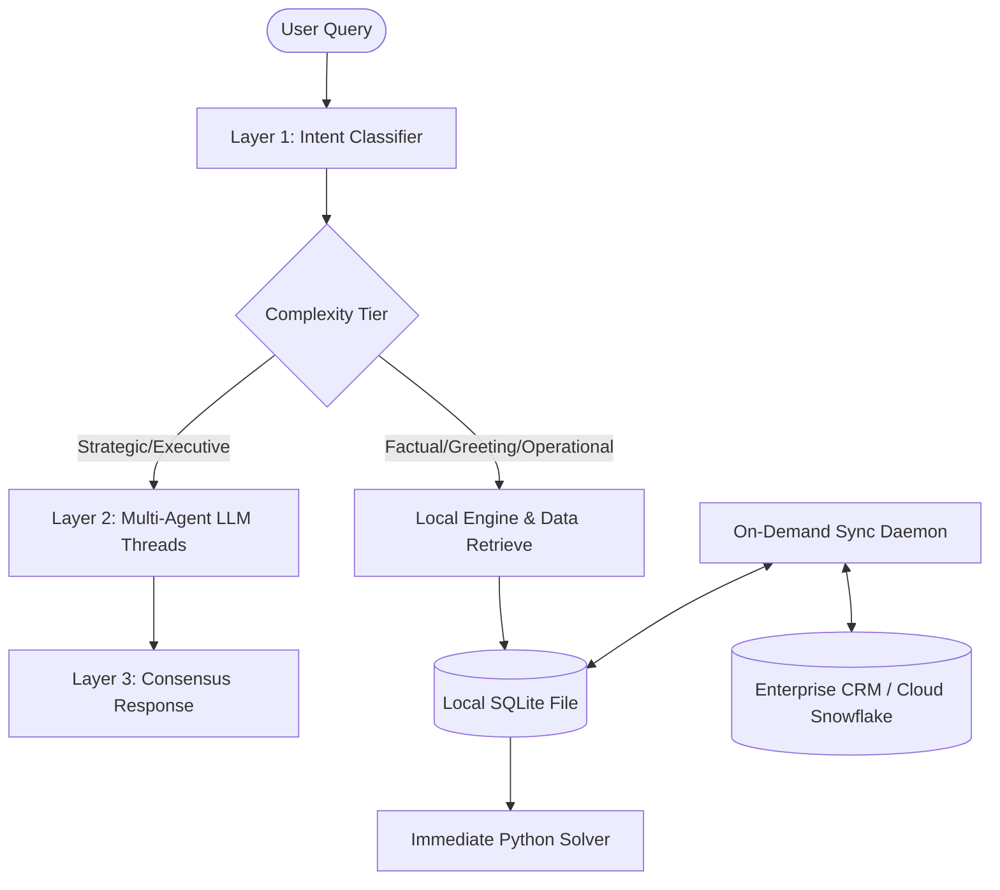

# APEX Account Planner — Database Architecture & Evolution Strategy

This document outlines the architectural trade-offs, recommended topology, and feature evolution strategy for the APEX Account Planner database layers, balancing the "local-first" USP with enterprise scalability.

---

## 1. Architectural Topology: Local vs. Cloud Trade-offs

The flowchart below visualizes how the hybrid local-first architecture interacts with local cached storage (SQLite/DuckDB) for high-speed local processing, and syncs on-demand with remote enterprise systems:

### Strategic Comparison: Local vs. Cloud Datastores

To preserve the APEX core value proposition of complete privacy, offline capability, and zero cloud API latencies, we evaluate database positioning below:

| Dimension | Option A: Pure Local DB (Current PostgreSQL) | Option B: Pure Cloud DB (e.g., Supabase / AWS RDS) | Option C: Hybrid Local-First Engine (Recommended) |
| :--- | :--- | :--- | :--- |
| **Data Security & USP** | **Excellent**: Enterprise CRM details never leave the machine. Zero external transit. | **Poor**: Violates privacy guidelines for local-only processing. | **Excellent**: Active user session data, cache, and history remain strictly local. |
| **Maintenance Overhead** | **High**: Requires manual PostgreSQL server setup, port configuration, and service health checks on client machines. | **Low**: Managed services with automated backups and schema updates. | **Low**: Runs as an embedded serverless DB file within the Python runtime (no port setups). |
| **Offline Performance** | **Excellent**: Fully functional without internet connectivity. | **None**: The application crashes if the internet connection drops. | **Excellent**: Fully operates offline using local cache; syncs with cloud endpoints on connection. |

### Database Engine Selection Matrix

To select the ideal embedded local database engine, we evaluate the candidates below:

| Metric / Feature | SQLite (Recommended) | DuckDB (Analytical) | Local PostgreSQL (Current) | Cloud Database (Supabase) |
| :--- | :--- | :--- | :--- | :--- |
| **Setup & Dependencies**| Zero config (1 single file, 1 python import) | Zero config (1 single file, 1 python import) | Requires installing local service and binary | Requires cloud account and network config |
| **Memory Footprint** | Extremely low (<10MB RAM) | Medium (optimized for memory analytics) | High (runs continuous background processes) | Zero local footprint (handled on remote hosts) |
| **Query Types** | transactional (CRUD, session stores, lists) | analytical (large datasets, aggregations) | transactional & analytical | transactional & analytical |
| **Best Suited For** | Chat session history, local app state cache | Complex metrics, report queries over massive sheets | Distributed multiuser setups | Multiuser cloud collaborations |

### The Recommendation: Embedded Local Engine (SQLite / DuckDB) with Hybrid CRM Connectors
To eliminate PostgreSQL client-side installation overhead while protecting the "local-first" USP:
1. **Transition to SQLite/DuckDB for local storage**: Embedded, file-based SQL engines that require no local services, ports, or background server maintenance.
2. **On-Demand Secure Cloud Fetching**: Maintain a secure API client layer that pulls fresh records from enterprise systems (Salesforce, HubSpot, Snowflake) directly into the local file database on user command.

---

## 2. Advanced Feature Architecture & Roadmap

Integrating local-first intelligence allows adding rich, high-value collaborative and memory-based features:

### 1. Conversational Chat Session Memory (ChatGPT-style)
* **Objective**: Maintain conversational state across user prompts (e.g. tracking that *"their email"* refers to ServiceNow contacts from the previous query).
* **Implementation Plan**:
  * Create a local database schema `chat_sessions` and `chat_messages` in the embedded database.
  * Update Layer 1 (`IntentClassifier`) to concatenate the last 2-3 message exchanges as historical context to extract referential entities dynamically.

### 2. Local Semantic Search (Private Vector RAG)
* **Objective**: Ask unstructured questions across local account notes, emails, and meetings without forwarding private documents to cloud LLM APIs.
* **Implementation Plan**:
  * Embed a lightweight local vector library (e.g., **ChromaDB** or **LanceDB**) directly inside the Python project.
  * Integrate an on-device sentence transformer (e.g., `all-MiniLM-L6-v2`) via `sentence-transformers` or ONNX to generate and query local vector embeddings.

### 3. Background CRM Hygiene Daemon
* **Objective**: Proactively scan CRM records for inconsistencies, stale deals, or relationship risk metrics.
* **Implementation Plan**:
  * Execute periodic analytical SQL rules over the local tables (identifying deals with no updates > 14 days or contacts with low engagement).
  * Push alerts directly into the notifications stream on the frontend.

### 4. Styled PPTX/PDF Exporter
* **Objective**: Compile 7-day playbooks, stakeholder influence maps, and active risk mitigation actions into formatted slide decks or executive summaries.
* **Implementation Plan**:
  * Map Layer 3 output dictionaries directly to pre-configured document templates using libraries like `python-docx` and `python-pptx` to generate standard exports instantly.

### 5. Secure Encrypted Client Backups
* **Objective**: Securely package local workspace data (SQLite file, chat context, configuration) into a portable backup file.
* **Implementation Plan**:
  * Implement symmetric encryption (e.g., Python `cryptography.fernet`) to compress and password-protect local data exports.
